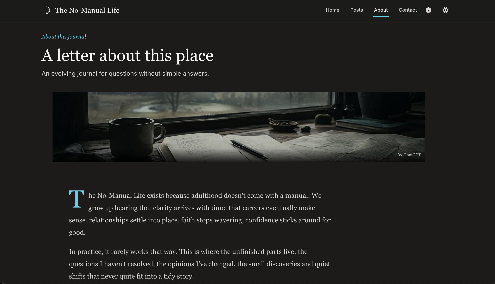

# The No-Manual Life Blog

### Accessibility-First Frontend Engineering Project



---

## 📌 Overview

The No-Manual Life Blog is a modern frontend engineering project built with **accessibility as a primary architectural constraint**.

This is not just a blog application — it is a structured environment created to practise, refine, and document inclusive
engineering patterns using scalable frontend architecture.

The project is intentionally designed to prioritise:

- Accessibility-first thinking
- Semantic structure
- Performance discipline
- Clean component architecture
- Type-safe development

It serves as both a learning laboratory and a professional showcase of accessibility-driven frontend engineering.

---

## 🎯 Engineering Focus

This project targets **WCAG 2.1 Level AA** and explores:

- Semantic HTML5 and proper landmark usage
- Keyboard-first interaction design
- Strategic and minimal ARIA usage
- Focus management and logical tab order
- Accessible typography and colour contrast
- Progressive enhancement principles
- Performance optimisation for constrained devices
- Robust, scalable component architecture

Accessibility is treated as a system-level concern — not a post-build adjustment.

---

## 🚀 Tech Stack

- **Next.js (App Router)**
- **TypeScript**
- **Tailwind CSS**
- **Radix UI** (accessible interaction primitives)
- **Playwright + Axe** (browser and automated accessibility tests)
- **axe-core** (development accessibility reports)
- **GitHub Actions** (continuous integration)
- **Vercel deployment**

---

## 🌐 Live Preview

🔗 https://the-no-manual-life-blog.vercel.app/

---

## 🛠 Local Development

Use **Node.js 24**, matching CI.

```sh
npm ci
npm run dev
```

Open [localhost:3000](http://localhost:3000).

---

## 🧪 Testing

Install Chromium once after installing the project dependencies:

```sh
npx playwright install chromium
```

Start with the interactive test runner to inspect each test and its actions:

```sh
npm run test:e2e:ui
```

| Command | Purpose |
| --- | --- |
| `npm run lint` | Check ESLint rules |
| `npm run typecheck` | Generate route types and check TypeScript |
| `npm run test:e2e` | Run the Chromium suite in the terminal |
| `npm run test:e2e:ui` | Explore and run tests interactively |
| `npm run test:e2e:report` | Open the last HTML test report |

The runner builds the production application with Webpack and starts it on
`http://127.0.0.1:3100`. Keep that port free; no separate development server is
needed. Screenshots and traces are retained on failure. Generated reports are
ignored by Git.

### Current Coverage

The initial suite in [`tests/e2e/home.spec.ts`](./tests/e2e/home.spec.ts) checks:

- Navigation from the home page to the journal.
- Axe WCAG A/AA checks on the home page in light and dark themes.

Automated checks cover only part of accessibility. Full keyboard, screen reader,
zoom and responsive validation remain pending; passing Axe does not establish
WCAG compliance.

---

## ⚙️ CI & Deployment

The [GitHub Actions workflow](./.github/workflows/ci.yml) runs on pull requests,
pushes to `main`, and manual dispatch:

1. Install dependencies with `npm ci` on Node.js 24.
2. Run ESLint and TypeScript checks.
3. Build the production application with Webpack.
4. Run Playwright and Axe against that build.
5. Upload available reports, screenshots and failure traces for 14 days.

CI builds once and uses one test worker. Tests that pass only on retry still
fail the CI check. Download artifacts from the workflow run in GitHub Actions;
open an extracted report with `npx playwright show-report <folder>`.

**Merge protection:** require pull requests and the `Quality checks` status for
`main` in GitHub branch rules after the first workflow run. The workflow alone
does not enforce merge protection.

**Deployment:** the existing Vercel Git integration provides Preview deployments
for PRs and Production deployments from `main`. CI and deployment run separately;
requiring checks before merge protects the normal path to Production.

---

## 🧠 Project Intent

This project is intentionally iterative.

The current implementation focuses primarily on accessibility foundations and structural quality.  
Future phases will expand into:

- Architecture scalability
- Dynamic content management
- Product-level UX improvements
- Advanced performance strategies
- Internationalisation
- Progressive Web App capabilities

---

## 🗺 Roadmap

See [`ROADMAP.md`](./ROADMAP.md) for structured development phases and future evolution plans.

---

## 👩‍💻 Author

Created by **Patricia Segantine**  
Senior Frontend Engineer building scalable, accessible web applications with a focus on performance and maintainability.
